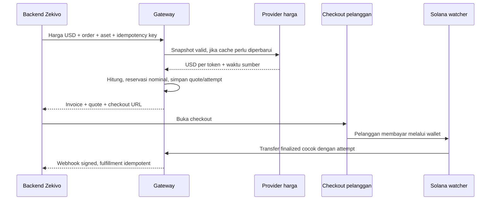

# Harga USD dan quote USDT/USDC

Status: **alur inti invoice USD/v2 tersedia di lokal/Devnet; belum dideploy Azure**. Adapter harga, cache bersama dan
konversi decimal sudah tersedia untuk localnet/Devnet; lihat [PRICING.md](PRICING.md).
Riset 18 Oktober 2026.
API invoice yang berjalan masih menerima `asset` dan `amount` dalam unit token.
Contoh USD di dokumen ini bukan body yang dapat langsung dikirim ke API v1.

## Rekomendasi sumber harga

Gunakan **CoinGecko Simple Price** sebagai adapter pertama untuk development /
staging. Satu permintaan mengambil harga USD untuk dua ID yang dipin: `tether`
(USDT) dan `usd-coin` (USDC). Identitas aset tidak ditentukan hanya dari simbol.
Dokumentasi endpoint menyediakan presisi dan `last_updated_at`, sehingga gateway
dapat memeriksa umur data. Ini adalah harga referensi agregat, bukan penawaran
jual/beli yang menjamin hasil penukaran.

Sumber resmi: [Simple Price](https://docs.coingecko.com/reference/simple-price),
[akses Demo](https://support.coingecko.com/articles/9471335603-user-guide-how-to-sign-up-for-coingecko-demo-api-and-generate-an-api-key).

| Kandidat | Penilaian untuk proyek |
| --- | --- |
| CoinGecko Demo | Rekomendasi development/staging nonkomersial. Gratis, kuota tercantum 10.000 panggilan/bulan; butuh key dan atribusi. Tidak dianggap izin production komersial. |
| CoinGecko Basic | Kandidat live untuk volume awal: halaman pricing menampilkan US$35/bulan dengan pembayaran tahunan; halaman lisensi saat riset menyebut Basic termasuk hak komersial. Harga checkout, periode pembayaran, atribusi dan cakupan penggunaan harus dikonfirmasi sebelum berlangganan. |
| Kraken public API | Tersedia ticker/order book dan pasangan USD. Dokumentasi API menyatakan penggunaan data publik secara komersial nonpersonal memerlukan izin terlebih dahulu; bukan fallback komersial otomatis. |
| Coinbase Exchange | Ada ticker dengan bid/ask dan waktu; ketentuan market data membatasi penggunaan/distribusi/derived works. Ketersediaan tiap pasangan serta hak penggunaan perlu diverifikasi sebelum menjadi provider. |
| Pyth Core / Hermes | Mendukung price feed, tetapi dokumentasi terbaru meminta API key; pengumuman upgrade menyebut paket mulai US$500/bulan. Tidak dipilih untuk kebutuhan/budget awal. |

Harga/kuota dapat berubah. Referensi:
[CoinGecko pricing](https://www.coingecko.com/en/api/pricing),
[lisensi CoinGecko](https://support.coingecko.com/articles/1043089972-what-are-the-differences-between-commercial-and-custom-licenses),
[Kraken API usage](https://docs-legacy.kraken.com/api/docs/guides/global-intro/),
[Coinbase market data terms](https://www.coinbase.com/legal/market_data),
[Pyth upgrade](https://www.pyth.network/blog/the-pyth-core-upgrade),
[Pyth developer hub](https://docs.pyth.network/).

Lisensi standar juga membedakan kalkulasi/display dari redistribusi data.
Sebelum live, pastikan rate yang dibawa response/webhook hanya bukti quote
transaksi, bukan feed harga yang dapat dipakai ulang oleh pihak lain. Syarat
penyimpanan/penghapusan data setelah berlangganan berakhir perlu diselaraskan
dengan retensi audit pembayaran sebelum memilih kontrak provider. Basic adalah
kandidat biaya awal, bukan jaminan seluruh cakupan gateway sudah terlisensi.

Belum membeli paket atau membuat akun/key provider. Biaya pihak ketiga ini
terpisah dari Azure dan tidak diasumsikan dibayar kredit startup Azure.
Estimasi infrastruktur US$197,44 + Basic US$35 = US$232,44/bulan ekuivalen,
belum pajak; melampaui target US$200 jika dihitung sebagai total biaya proyek.
Karena itu keputusan provider untuk live tetap perlu review anggaran. Tidak
memaksakan paket berbayar saat kita masih memakai Devnet/staging.

Probe API langsung Kraken/Coinbase dari mesin development gagal verifikasi
sertifikat TLS, termasuk saat memakai curl dengan verifikasi aktif. Tidak ada
payload harga/pair live yang berhasil divalidasi pada riset ini; hasil di atas
berasal dari dokumentasi resmi. Jangan menonaktifkan verifikasi TLS untuk
melanjutkan integrasi. Pengujian egress dari Azure masih diperlukan. Setelah key dikonfigurasi, probe
terautentikasi CoinGecko dari Devnet lokal berhasil; lihat PRICING.md. Kegagalan
TLS probe awal tidak dibypass.

## Pengambilan data dan kuota

Rancangan permintaan Demo dari backend saja:

```http
GET https://api.coingecko.com/api/v3/simple/price?ids=tether,usd-coin&vs_currencies=usd&include_last_updated_at=true&precision=full
x-cg-demo-api-key: <secret dari environment/Key Vault>
```

- Cache on-demand 60 detik, bersama untuk kedua aset; tidak ada polling harga
  background terus-menerus. Gabungkan permintaan concurrent agar tidak terjadi
  stampede. API key tidak dikirim ke browser atau dicetak di log.
- 100 invoice/hari × 30 hari ≈ 3.000 permintaan sebelum cache, jika satu batch
  per invoice. Retry, pemilihan aset dan trafik lainnya tetap dihitung.
- Refresh tiap menit sepanjang bulan justru sekitar 43.200 panggilan/30 hari;
  jangan memakai pola tersebut pada Demo 10.000 panggilan.
- Harga tidak diambil lagi setiap polling status checkout. Quote yang sudah
  tersimpan dikembalikan dari database. Replikasi proses memakai cache/batas
  kuota bersama, bukan kuota independen per replica.
- Ambang awal rancangan: umur `last_updated_at` maksimal 180 detik, timestamp
  tidak di masa depan di luar toleransi clock, timeout 5 detik, retry terbatas
  dengan backoff dan anggaran kuota. Angka ini konfigurasi awal, bukan SLA.
- Data nonpositif, hilang, timestamp invalid, respons rusak, 429 atau quota habis
  menghentikan penerbitan quote baru jika cache tidak lagi valid. Jangan diam-diam
  memakai 1 USD = 1 token. Provider alternatif hanya boleh dipakai jika adapter,
  identitas, mutu data dan izin penggunaannya sudah disetujui.
- Rancangan breaker depeg: hentikan quote baru jika harga keluar dari 0,99–1,01
  USD/token. Ambang harus ditinjau sebelum live. Tidak mengubah nominal quote
  yang sudah aktif atau menandai dana yang terlanjur masuk sebagai hilang.
- Parser harga harus mempertahankan angka desimal dari payload; hindari
  `Number`, `parseFloat`, atau `response.json()` yang menghilangkan presisi sebelum
  dinormalisasi ke decimal string. Simpan snapshot yang dipakai untuk audit.

Localnet memakai provider fixture deterministik untuk tes. Mock USDT Devnet
bukan token yang diperdagangkan: harga USDT dunia nyata hanya boleh dipakai
sebagai simulasi konversi, diberi label token uji. Pemeriksaan pembayaran tetap
memakai mint jaringan yang dipin, bukan ID CoinGecko.

## Alur yang disepakati untuk diimplementasikan

1. Backend Zekivo menetapkan harga akhir pesanan USD. Harga dari browser tidak
   menjadi sumber kebenaran. Project ditentukan API key, bukan klaim tenant di body.
2. Zekivo membuat invoice USD dengan idempotency key. Gateway memvalidasi scope,
   order, USD dua desimal, aset dan jaringan yang diizinkan untuk project.
3. Gateway mengambil snapshot harga valid, menghitung quote dengan decimal /
   integer, membulatkan naik ke enam desimal token dan mengalokasikan kode unik
   dalam transaksi database. Tambahan unik terpisah dari harga dan fee.
4. Quote dan payment attempt tersimpan immutable bersama rate, sumber, waktu,
   formula/policy version, pembulatan, dan base units. Default rancangan masa
   bayar 900 detik. Quote dan invoice berakhir bersamaan; angka bukan API aktif.
5. Checkout menampilkan harga pesanan USD, total token persis, jaringan, QR,
   countdown dan status. Rincian kurs/kode unik dapat dibuka. Tidak menampilkan
   USD seolah-olah nilai uang tunai yang dijamin dapat dicairkan.
6. Pelanggan mengirim token. Watcher memeriksa mint, penerima, jumlah, reference /
   aturan pencocokan, waktu dan finality sesuai kontrak pembayaran yang ada.
7. Penetapan paid memakai nominal token attempt yang sudah dikunci, bukan kurs
   baru pada saat polling/konfirmasi. Simpan pembayaran, ledger dan outbox atomik.
8. Webhook signed menyampaikan identitas pesanan, nilai pesanan USD, snapshot
   quote dan jumlah token diterima. Backend Zekivo memverifikasi signature,
   mengaitkan order, dan fulfillment secara idempotent.



Nilai terkunci **bukan hedging**. Perubahan harga token, biaya penukaran dan biaya
penarikan bisa memengaruhi USD yang akhirnya didapat merchant. Dana tetap di
wallet dalam USDT/USDC; rancangan ini tidak melakukan swap atau pencairan USD.

## Contoh matematika, bukan kurs live

Harga pesanan US$25,83; rate ilustrasi 0,999 USD per 1 USDT:

```text
converted_amount = ceil_to_6_decimals(25.83 / 0.999) = 25.855856 USDT
unique_adjustment = 0.000001 USDT
payable_amount = 25.855857 USDT
payable_units = 25855857
```

Tidak mengalikan USD dengan rate yang arahnya USD/token. Jangan membulatkan
nominal token menjadi dua desimal. SOL fee dibayar terpisah oleh pengirim;
tambahan identifikasi bukan biaya jaringan atau spread tersembunyi.

## Draft JSON integrasi baru

Endpoint terpisah `POST /v2/invoices` menjaga arti
`amount` pada v1 yang sudah berjalan. Schema aktif tersedia pada OpenAPI dan INVOICE-API.md. Semua nilai uang adalah string.

```http
Authorization: Bearer <API key project dari backend Zekivo>
Idempotency-Key: ZKV-2026-000123-payment-1
Content-Type: application/json
```

```json
{
  "order_id": "ZKV-2026-000123",
  "price_currency": "USD",
  "price_amount": "25.83",
  "payment_asset": "USDT",
  "allowed_payment_assets": ["USDT", "USDC"],
  "network": "solana",
  "expires_in_seconds": 900,
  "description": "Pesanan ZKV-2026-000123",
  "metadata": {
    "zekivo_order_reference": "ZKV-2026-000123"
  }
}
```

Field wajib rancangan: `order_id`, `price_currency`, `price_amount`,
`payment_asset`, `network`. `allowed_payment_assets` default hanya aset terpilih;
`expires_in_seconds` default 900, maksimum sesuai kebijakan quote project.
`description`/`metadata` opsional, dibatasi ukuran dan tidak berisi data sensitif.
Merchant name berasal dari konfigurasi project; nama produk/description dari
backend yang dipercaya tetap di-escape ketika dirender. Tidak menerima rate,
wallet penerima, mint, fee, project ID atau webhook URL bebas dari body ini.
Webhook URL/secret dikonfigurasi pada project yang sudah terautorisasi.

Contoh bagian response (ID sintetis dan rate ilustrasi; bukan response API aktif):

```json
{
  "id": "11111111-1111-4111-8111-111111111111",
  "order_id": "ZKV-2026-000123",
  "status": "pending",
  "price_currency": "USD",
  "price_amount": "25.83",
  "asset": "USDT",
  "cluster": "devnet",
  "quote": {
    "id": "22222222-2222-4222-8222-222222222222",
    "source": "fixture",
    "market_asset_id": "tether",
    "rate_usd_per_token": "0.99900000",
    "rate_source_updated_at": "2026-10-18T00:00:00Z",
    "created_at": "2026-10-18T00:00:30Z",
    "expires_at": "2026-10-18T00:15:30Z",
    "converted_amount": "25.855856",
    "unique_adjustment": "0.000001",
    "rounding": "ceil_token_6",
    "policy_version": "usd-quote-v1"
  },
  "payable_amount": "25.855857",
  "payable_units": "25855857",
  "expires_at": "2026-10-18T00:15:30Z"
}
```

Response riil juga perlu checkout URL, konfigurasi pembayaran aman dan versi
invoice sesuai kontrak yang ada. Contoh ini sengaja tidak menerbitkan capability
checkout atau alamat operasional. Field quote penuh untuk audit backend;
projection checkout publik dan webhook memiliki schema tersendiri, bukan dump
record database. Webhook akan membawa `price_currency`, `price_amount`, `asset`,
`quote_id`, rate terkunci, `payable_amount` dan `received_amount` di samping
ID/version/event yang sudah ada. Perlu versioning schema dan kompatibilitas
consumer; jangan mengubah arti event lama tanpa migrasi.

## Retry, quote berakhir, dan pilihan aset

- Retry dengan project/idempotency key/body sama mengembalikan invoice/quote
  semula, termasuk bila expired. Body berbeda pada key sama tetap konflik.
- Jangan memperbarui kurs, QR atau batas waktu invoice aktif diam-diam. Invoice
  yang kedaluwarsa memerlukan alur pembuatan pembayaran baru yang eksplisit;
  order tetap dilindungi dari fulfillment ganda dan late transfer ditinjau.
- Quote USDT dan USDC terpisah karena rate berbeda. Saat pilihan aset diganti,
  gunakan quote valid yang sudah tersimpan atau terbitkan attempt versi baru
  secara eksplisit dalam batas waktu invoice yang sama. Jangan menghidupkan QR
  attempt lama atau mengabaikan transfer yang sudah dikirim.
- Provider down tidak mematikan polling invoice atau pemeriksaan transfer
  quote yang sudah ada. Harga live hanya dibutuhkan untuk menerbitkan quote baru.
- Jika provider/kuota tidak siap, tolak sebelum membuat invoice yang seolah bisa
  dibayar. Tandai readiness komponen harga untuk operator, bukan menghalangi
  rekonsiliasi pembayaran yang sedang berlangsung.

## Urutan implementasi berikutnya

- [x] Schema API USD/v2 dan compatibility v1; update OpenAPI/Scalar.
- [x] Decimal conversion + fixture provider; uji cents, rounding, nilai besar/kecil.
- [x] Adapter CoinGecko, key server-side, cache bersama dan quota/error handling.
  Berjalan melalui CLI operator; belum terhubung ke penerbitan invoice.
- [x] Migrasi snapshot quote per aset, harga asli dan reservation amount atomik.
- [x] Integrasi create invoice USD + idempotency + pilihan aset dan expiry.
- [x] Checkout menampilkan harga USD dan nominal token dari quote server.
- [ ] Webhook schema versioned + contoh integrasi backend Zekivo dan fulfillment.
- [ ] Playground USD dengan fixture; tes live provider terpisah dari CI deterministik.
- [ ] Staging: key Demo, atribusi, egress TLS, freshness/depeg dan outage checks.
- [ ] Sebelum live: lisensi komersial/provider fallback, budget dan uji pembayaran.

Implementasi saat ini menyimpan quote per aset di invoice; attempt menyimpan base/payable units dan expiry yang sama. Field USD/quote ditambahkan opsional pada webhook schema 1, bukan migrasi nomor schema. Contoh di atas tetap ilustrasi; untuk kontrak aktif lihat INVOICE-API.md.
